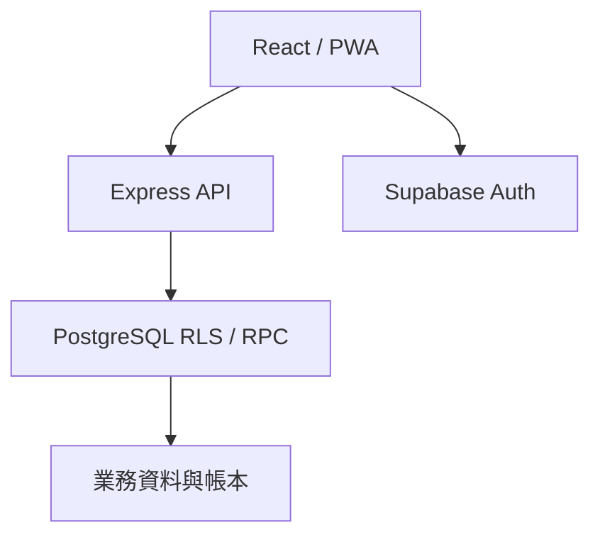

# 架構與權限

## 資料流

學生／管理員 React → Express `/api/v1` → 攜帶使用者 JWT 的 Supabase SDK → RLS / PostgreSQL RPC。登入與 session refresh 直接使用 Supabase Auth SDK；Express 用 `auth.getUser(token)` 向 Auth 伺服器驗證 token，不能只解碼 JWT。一般 API 不使用 service role。`scripts/create-demo-users.mjs` 是獨立、本機限定的帳號初始化工具。

## RBAC

| 功能 | 未登入 | 學生 | 老師 | 品牌管理員 | 平台管理員 |
|---|---|---|---|---|---|
| 公開品牌、課程、場次 | 讀取 | 讀取 | 讀取 | 讀取 | 讀取 |
| 學生私人資料、方案及帳本 | 無 | 自己 | 不可讀完整學生個資 | 所屬品牌 | 所有品牌 |
| 場次學生名單、出勤 | 無 | 僅自己出勤 | 自己授課場次 | 所屬品牌 | 所有品牌 |
| 預約／取消 | 無 | 自己 | 可另具學生身分 | 依管理操作 | 依管理操作 |
| 堂數授予與調整 | 無 | 無 | 無 | 所屬品牌 | 所有品牌 |
| 排課與內容管理 | 無 | 無 | 僅查看自己的排課 | 所屬品牌 | 所有品牌 |
| 建立／啟停品牌、設定品牌管理員 | 無 | 無 | 無 | 無 | 可 |

一個帳號可同時具有多個品牌角色。`platform_admins` 不由瀏覽器直接寫入。老師的帳號 UUID 綁定至 `teachers.profile_id` 時，trigger 同步老師角色；不活躍或解除綁定會停用該品牌老師角色。老師學生名單只回傳姓名與預約／出勤必要資料。

## 業務狀態

- 場次：`scheduled`、`cancelled`、`completed`；現有介面支援建立與取消，歷史顯示亦參照開始時間。自動將場次標記完成的排程尚未提供。
- 預約：`confirmed` → `cancelled`；schema 保留 `completed`、`no_show`，目前出席／缺席獨立記於 attendance，不會自動改寫預約狀態。
- 交易以 RPC 單筆 PostgreSQL 交易處理，帳本不能從一般前端直接修改。
- 登入成功後會嘗試將使用者加入目前品牌的學生角色；若加入失敗，使用者可到「我的資料」手動加入。

## 範圍與已知缺口

學生和老師先自行註冊；管理員可將已註冊學生加入品牌，但不能在後台替未註冊者建立 Auth 帳號。授課紀錄提供場次、報名及出席人數與時長；老師僅能讀取自己的場次。一般管理列表與學生列表提供分頁，其他查詢仍有上限；詳細限制及整合驗證狀態見測試報告。

品牌管理員可存取所屬品牌的所有分店；目前沒有授權限制至特定分店的功能。
