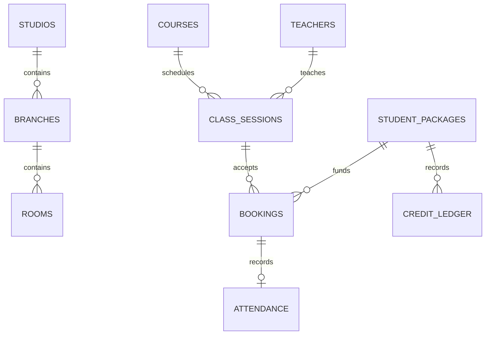

# 資料庫設計與命名

十一份 `supabase/migrations/*.sql` 是結構來源；`npm run db:sql` 產生供 SQL Editor 全新安裝的 `00` 整合檔、`01` 結構檔與 `02` 示範資料檔。`supabase/seed.sql` 是開發資料，SQL Editor 的 `02` 含重複匯入保護。兩條安裝路徑不要混用。所有時間戳使用 `timestamptz`；品牌分店時區預設 `Asia/Taipei`，星期 `0` 至 `6` 分別代表週日到週六。

## 資料表對照

除 `profiles`、`platform_admins`、`studios` 外，主要營運資料以 `studio_id` 區分品牌。`id` 是 UUID；`created_at`／`updated_at` 為建立／更新時間，具體欄位和約束以 migration 為準。

| Table | 用途與主要欄位 |
|---|---|
| `profiles` | Auth 使用者個人資料；`id` 對應 `auth.users.id`，含 `full_name`、`email`、`phone`、`birthday`，不存密碼。 |
| `platform_admins` | `user_id` 指向平台管理員；具跨品牌管理權限。 |
| `studios` | 品牌；`name`、`slug`、`is_active`。 |
| `studio_memberships` | 帳號與品牌的 `role`（admin／teacher／student）、`is_active` 及品牌內 `notes`。 |
| `student_details` | 品牌內學生資料；`studio_id`、`membership_id`、`student_id`、`full_name`、`phone`、`birthday`，與其他品牌隔離。 |
| `branches` | 分店；`name`、`address`、`timezone`、`is_active`。 |
| `rooms` | 教室；`branch_id`、`name`、`capacity`、`is_active`。 |
| `room_availability` | 教室可使用的星期及時間；`room_id`、`weekday`、`start_time`、`end_time`、`is_active`。 |
| `teachers` | 老師資料；`profile_id` 可綁定登入使用者，並有 `name`、`photo_url`、`specialty`、`bio`。 |
| `teacher_branches` | 老師可授課的分店關聯：`teacher_id`、`branch_id`。 |
| `teacher_courses` | 老師課程資格：`teacher_id`、`course_id`。 |
| `teacher_availability` | 可授課星期與時間；`weekday`、`start_time`、`end_time`、可選 `branch_id`；空值代表所有已指派分店。 |
| `teacher_time_off` | 老師不可授課區間：`starts_at`、`ends_at`。 |
| `course_categories` | 課程分類與排序。 |
| `courses` | 課程；`category_id`、`name`、`description`、`difficulty`、`duration_minutes`、`default_capacity`、`credit_cost`、`image_url`。 |
| `course_favorites` | 學生收藏與課程關聯；`studio_id`、`student_id`、`course_id`，不重複儲存課程內容。 |
| `schedule_rules` | 單次或每週排課規則：`frequency`、`until_date`。 |
| `class_sessions` | 實際場次；`branch_id`、`room_id`、`course_id`、`teacher_id`、`original_teacher_id`、時間、容量、`booking_opens_at`、`booking_closes_at` 與取消期限。 |
| `course_packages` | 方案模板：`total_credits`、`validity_days`、`price`、`applies_to_all`。 |
| `package_courses` | 不適用全部課程時，方案與課程的關聯。 |
| `student_packages` | 學生持有的方案、`granted_credits`、`balance`、有效期間及狀態。 |
| `bookings` | 預約：`session_id`、`student_id`、`student_package_id`、`credits_charged`、`cancellation_deadline_at` 及狀態。 |
| `credit_ledger` | 不可覆寫的堂數異動：`entry_type`、`delta`、關聯學生方案／預約、操作人與 `idempotency_key`。 |
| `attendance` | 每筆預約的出勤 `status` 與 `marked_by`。 |
| `site_settings` | 品牌網站標題、聯絡資訊與 `brand_tagline`。 |
| `homepage_sections` | 首頁區塊、文字、圖片／連結、排序、啟用。 |
| `banners` | 首頁 Banner 內容與排序。 |
| `booking_settings` | 預設 `cancellation_hours`。 |
| `announcements` | 公告內容與顯示區間。 |
| `audit_logs` | 重要資料的操作人、資料表、操作與前後內容。 |

品牌內學生姓名、電話、生日由 `student_details` 管理，備註使用 `studio_memberships.notes`。建立學生身分時從 `profiles` 初始化一份資料；之後品牌內資料與帳號個人資料各自維護，品牌管理員修改不會更動其他品牌或帳號的 `profiles`。

## 核心交易及一致性

- 場次、教室與學生方案等關聯採品牌複合外鍵；教室必須屬於所選分店，預約的方案必須屬於同一品牌的同一學生，帳本與預約亦須一致。
- `issue_student_package` 在同一交易授予方案並建立 GRANT 帳本。`book_class_session` 鎖定場次與方案，檢查身分、名額、可使用方案、有效期與堂數，成功才一起寫入預約、扣堂及帳本。相同請求鍵避免重複操作。
- 建立預約時計算並保存 `bookings.cancellation_deadline_at`；之後變更 `booking_settings` 不會追溯更改該預約。學生須在期限內取消，管理員可在開課前處理。取消場次或預約時退款與帳本異動在同一交易完成。
- `adjust_student_credits` 需有原因、非零整數與請求鍵。帳本不可更新或刪除；最後餘額必須等於該方案帳本 `delta` 總和，交易結束時由資料庫檢查，不符即回滾。
- 教室與老師重疊由 GiST 排除約束處理；trigger 檢查分店、資格、老師可授課時段、請假與容量。已預約場次不得直接更動課程或時間。每週排課最多 90 天；目前不支援跨日授課。
- RLS 限制學生、任課老師、品牌管理員與平台管理員能讀取的資料；直接寫入交易表被禁止，授權函式固定 `search_path` 並重新檢查身分。正式 Supabase 仍須實際驗證各角色與 Storage policies。

## 週期、可用時段與報表

`room_availability` 未設定任何啟用時段時，新增場次不受教室可用時段限制；已設定時，新建或修改的場次須落在該日其中一個時段內。修改時段不會回頭改寫既有場次。`weekday` 使用分店時區，0 為週日；跨日授課未支援。

`business_metrics` 依所選區間、分店及場次狀態計算：課程預約率＝未取消場次的有效預約數／有效名額；出席率＝已出席／（已出席＋缺席）；取消率＝取消預約／全部預約；教室使用率＝與可用時段相交的非取消排課分鐘／可用分鐘。分母為零時顯示 `—`；若選取範圍內任何啟用教室缺少可用時段，教室使用率為未定義。重疊可用時段合併計算。報表採用目前的教室時段，因此日後改設定會影響歷史區間的使用率。

學生身份在品牌內由 `student_details` 持有，收藏透過複合外鍵對應同品牌學生與課程；每人每課程最多一筆。收藏讀取僅限本人，增減走 RPC。品牌管理員目前可管理整個所屬品牌所有分店，沒有個別分店管理員授權。

每場可設定 `booking_closes_at`；空值時以開課時間截止。若有設定，截止時間須不早於開放時間且不晚於開始時間。新增預約時資料庫 trigger 在同一交易內再次檢查，重試既成功的冪等請求不會重複扣堂。每週場次的截止時間依首次場次的偏移同步移動。
