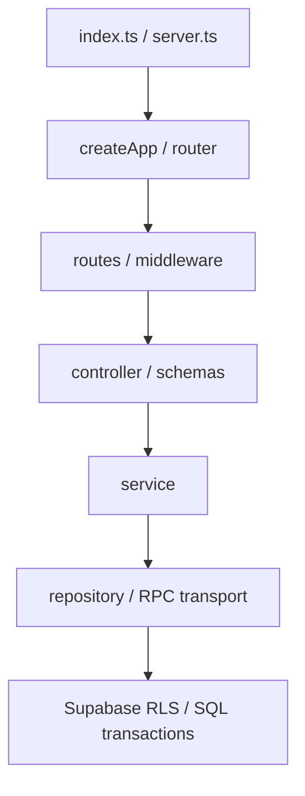

# Flowie 現行架構與維護位置

本文件描述本次整理後的現行程式。舊版程式與上版驗證已封存於 `archive/previous-layout-reference.zip`，不再與現行 source 並存。

## 前端

`index.html → src/main.tsx → app/bootstrap.tsx` 是唯一啟動流程。bootstrap 只建立 React root；`app/providers/AppProviders.tsx` 組合 QueryClientProvider、BrowserRouter、AppProvider，保留原查詢策略。`app/router/AppRoutes.tsx` 註冊原 URL 與 lazy routes，layouts 處理導覽及工作區呈現。

| 層 | 可依賴 | 職責 |
|---|---|---|
| app | features、shared | 啟動、Provider、路由、版型組裝 |
| features | shared、必要的其他 feature 元件 | 每項既有功能的頁面、表單及互動 |
| shared | 共用套件與其他 shared 模組 | HTTP、Auth client、型別、UI primitive、通用工具 |

shared 不反向匯入 features／app，features 不匯入 app。個別頁面透過 React Query 和共用 HTTP client 讀資料，不直接操作 Supabase table／RPC。瀏覽器 Supabase client 用於 Auth，集中 `shared/auth/supabase-client.ts`。資料庫交易不在前端實作。

UI 沿用 React＋Radix UI＋Tailwind／品牌 CSS。Button／Dialog primitive 集中 `shared/ui/primitives`，Modal、Heading、Loading 等共用 UI 放 `shared/ui`；ClassCard 具有課程語意，留在 `features/classes/components`。Mantine 是可替代的 React UI library，不是本案現有依賴，也不決定 Express 分層；本次沒有加入或遷移元件庫。

樣式由 `styles/index.css` 依原順序匯入 foundation、components、layout、features、responsive、overrides。移除舊 `styles/main.css` 重複內容，但完整展開後的原 CSS 指紋維持一致；沒有重新設計畫面。

## 後端

| 檔案層 | 責任 |
|---|---|
| index.ts | Node CLI 唯一入口，啟動及註冊關閉流程 |
| server.ts | listen、啟動錯誤、SIGINT／SIGTERM 關閉，不放查詢 |
| app/create-app.ts | 建立獨立 Express app，掛載 middleware／router，不 listen、不執行 SQL |
| *.routes.ts | URL、HTTP 方法與授權 middleware |
| *.controller.ts | 以 schemas 驗證輸入、HTTP status、data/meta 包裝 |
| *.schemas.ts | Zod 輸入契約與既有資源欄位白名單 |
| *.service.ts | 功能協調與既有權限範圍，不接收 Express Request／Response |
| *.repository.ts | Supabase 查詢與映射，不處理 HTTP |
| infrastructure/database/rpc.ts | 共用 RPC transport，簡單 RPC 不硬建空 repository |
| shared/ | middleware、共用驗證、最小 ServiceContext、async handler |

九個現有領域：public-content、auth、favorites、scheduling、bookings、credits、students、reports、catalog。Controller 透過 toServiceContext() 傳入 db 與必要使用者資訊。預約、扣堂、取消退堂與排課交易保留在既有受控 RPC；每個請求仍使用呼叫者 JWT，未改用 service role 繞過 RLS。

## 設定與資料

- npm workspaces 維持 frontend／backend；root lockfile 不變。
- Vite、Tailwind、PostCSS、ESLint、Prettier 標準入口只轉交 `config/tooling`。移除較優先的舊 `.prettierrc.json` 重複設定，內容相同。
- `config/environment/loader.mjs` 為環境載入來源；`.env` 與分類環境檔保留原內容，未改優先序。
- `supabase/sql` 是唯一現行 SQL 來源，完整保留 01～07、安裝說明及精確 ER 圖。舊根目錄 SQL、v1_incremental 及 legacy/v1_2 移至 archive。
- `tests` 是唯一現行測試位置；舊 frontend/tests、backend/tests 及 scripts/test-v1-* 已封存。
- `.git` 的所有檔案保留原位元組。沒有執行 Git 的 stage、commit、reset、clean、gc 或 push。

## 架構檢查

`npm run check:architecture` 檢查相對 import／re-export、循環依賴、上下層限制、controller 越層存取、service 的 Express 相依、HTTP Request 洩入 service、現行函式說明、SQL 指紋、API 路由、圖片及 CSS 指紋。新增禁止已移除重複檔案再出現的檢查，可偵測直接覆蓋後殘留舊檔的情形。

`tests/backend/route-contract.test.ts` 額外從 Express 真正註冊的 router 展開路由，對照原 68 個端點基準，涵蓋動態 catalog 路由；不只信任靜態檢查中的名稱清單。靜態檢查仍不能取代業務驗收，亦不證明所有 any 型別已消除。

新增或維護功能時先到既有 feature／domain 找對應位置；沿用現有型別與 schema，不另建第二套 pages、services、routes 或整包業務工具檔。本次不新增業務功能。
